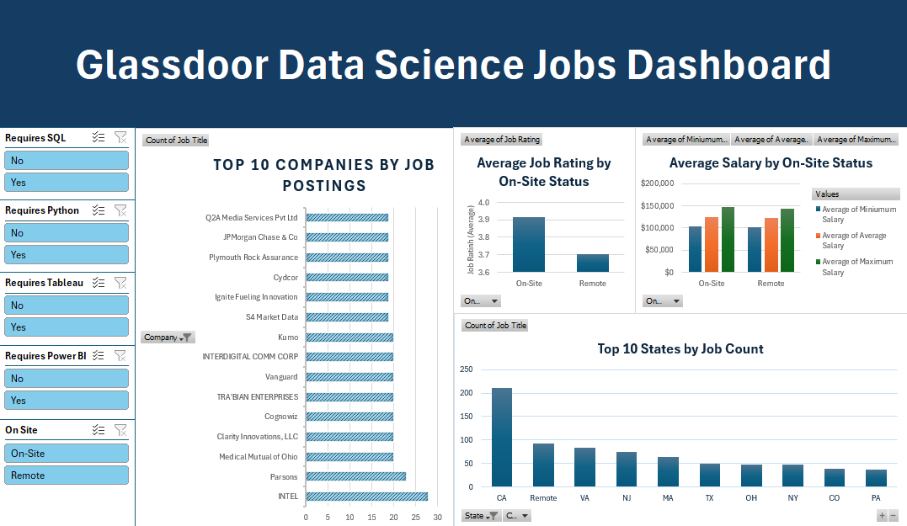

# Glassdoor Data Science Jobs Analysis

## Project Overview

This project analyzes Glassdoor Data Science job listings using **T-SQL and Microsoft Excel**.

The raw job-posting data contained inconsistent salary formats, company names mixed with ratings, inconsistent location formats, missing values, and unstructured job descriptions. I used SQL Server to clean and transform the raw data into an analysis-ready dataset, then used Excel PivotTables, PivotCharts, and slicers to build an interactive dashboard.

The project focuses on understanding how Data Science job requirements, salaries, ratings, companies, and geographic locations vary across job postings.



## Tech Stack

- **Database & Data Cleaning:** SQL Server / T-SQL
- **Analysis & Visualization:** Microsoft Excel
- **Excel Features:** PivotTables, PivotCharts, Slicers
- **Data Techniques:** CTEs, string parsing, conditional logic, data type conversion, feature engineering, aggregation

## Data Pipeline

### 1. Raw Data & Staging

The original Glassdoor job-posting dataset was copied into a working table before transformation.

```sql
SELECT *
INTO DS_Jobs
FROM GlassdoorCleaning..GlassdoorJobs;
```

This created a separate working copy of the source data while preserving the original dataset.

The raw data contained issues such as:

- **Salary estimates containing text such as (Glassdoor est.)**
- **Employer-provided salary labels**
- **Hourly and annual salary listings using different formats**
- **Company names containing embedded ratings**
- **Locations represented as cities, states, abbreviations, or Remote**
- **Missing or invalid values represented by -1**
- **Technical requirements embedded within unstructured job descriptions**

### 2. SQL Data Cleaning & Transformation

The majority of the data preparation was performed in T-SQL rather than manually in Excel.

A series of Common Table Expressions (CTEs) was used to progressively clean and transform the raw data.

**Salary Cleaning**

Salary strings were standardized by removing Glassdoor-specific text and identifying hourly listings.

```sql
LTRIM(RTRIM(
    REPLACE(
        REPLACE(
            REPLACE(Salary_Estimate,
                ' (Glassdoor est.)', ''),
                'Employer Provided Salary:', ''),
                ' Per Hour', '')
)) AS Cleaned_Salaries
```

Salary ranges were then separated into minimum and maximum values using CHARINDEX and SUBSTRING.

The resulting values were converted to numeric fields, with hourly salaries annualized using a 2,080-hour work year.

```sql
CASE
    WHEN Is_Hourly = 1
        THEN TRY_CAST(Min_Sal_Clean AS DECIMAL(10,2)) * 2080
    ELSE TRY_CAST(Min_Sal_Clean AS DECIMAL(10,2)) * 1000
END AS Min_Salary
```

This produced standardized Min_Salary and Max_Salary fields that could be used for mathematical analysis in SQL and Excel.

**Company Name Cleaning**

Some company names contained their Glassdoor rating within the same field.

The newline character was identified using `CHAR(10)` and used to isolate the company name from the embedded rating.

This produced a standardized `Company_Name_Cleaned` field for aggregation and visualization.

**Location Standardization**

Location data was separated into standardized City and State fields.

A state mapping table was created to convert full state names into their two-letter abbreviations while also handling:

- **City/state combinations**
- **State-only locations**
- **State abbreviations**
- **Remote positions**
- **United States / US**
- **Unspecified locations**

This allowed job postings to be consistently grouped by geographic location.

**Rating Cleaning**

Invalid ratings represented by `-1` were converted to `NULL`, while valid ratings were rounded to one decimal place.

```sql
NULLIF(ROUND(Rating, 1), -1) AS Rating_Rounded
```

This prevented invalid placeholder values from being included in rating-based analysis.

**Technical Skill Extraction**

The job descriptions were searched for common technical requirements and converted into binary analytical fields.

```sql
CASE
    WHEN LOWER(Job_Description) LIKE '%sql%' THEN 1
    ELSE 0
END AS ReqSQL
```

Similar fields were created for:

- **SQL**
- **Python**
- **Tableau**
- **Power BI**

These fields allowed technical requirements to be analyzed independently and used as interactive filters in Excel.

**Work Arrangement Classification**

An `OnSite` field was created to distinguish remote listings from non-remote listings.

```sql
CASE
    WHEN Location = 'Remote' THEN 0
    ELSE 1
END AS OnSite
```

This allowed salary and rating metrics to be compared between remote and on-site job postings.

### 3. Cleaned Analytical Dataset

The transformed fields were written into a new `Cleaned_Listings` table.

The resulting dataset contains standardized fields including:

- **Job title**
- **Company**
- **Rating**
- **City**
- **State**
- **Minimum salary**
- **Maximum salary**
- **SQL requirement**
- **Python requirement**
- **Tableau requirement**
- **Power BI requirement**
- **On-site / remote status**

This table serves as the primary analytical dataset for the remainder of the project.

## SQL Analysis

After cleaning the data, I used SQL to investigate several aspects of the Data Science job market.

**Salary Analysis**

Analyzed:

- **Average minimum and maximum salary by work arrangement**
- **Average salary by city and state**
- **Salary spread between minimum and maximum estimates**
- **Salary differences across technical skill profiles**
- **Salary differences by company rating**

For example, salary spread was calculated as:

```sql
AVG(Max_Salary - Min_Salary) AS AverageSalarySpread
```

This provided an additional measure of how wide advertised compensation ranges were across different groups.

**Technical Skill Analysis**

Job descriptions were categorized based on combinations of SQL, Python, Tableau, and Power BI requirements.

The resulting profiles included:

- **Full-Stack Analyst**
- **Data Engineer / Backend Analyst**
- **Traditional BI Analyst**
- **Python Specialist / Data Scientist**
- **Baseline / Non-Technical**
- **Other Specialized Stack**

These profiles were then compared based on:

- **Number of job postings**
- **Average minimum salary**
- **Average maximum salary**
- **Average salary spread**

**Geographic Analysis**

Job postings were aggregated by city and state to examine geographic differences in:

- **Job availability**
- **Average salary**
- **Salary ranges**
- **Work arrangements**

## Excel Dashboard

The cleaned SQL dataset was imported into Microsoft Excel and used to build an interactive dashboard with PivotTables, PivotCharts, and slicers.

### Dashboard Features

- **Top 10 Companies by Job Postings**
- **Top 10 States by Job Count**
- **Average Job Rating by On-Site Status**
- **Average Salary by On-Site Status**

### Interactive Filters

The dashboard includes slicers for:

- **SQL requirements**
- **Python requirements**
- **Tableau requirements**
- **Power BI requirements**
- **On-site / remote status**

These filters allow users to dynamically explore different subsets of the job market without modifying the underlying dataset.

### Project Workflow

```text
Raw Glassdoor Data
        │
        ▼
   SQL Staging Table
        │
        ▼
   Data Cleaning
        │
        ├── Salary Parsing
        ├── Location Standardization
        ├── Company Name Cleaning
        ├── Rating Cleaning
        ├── Technical Skill Extraction
        └── Work Arrangement Classification
        │
        ▼
   Cleaned_Listings
        │
        ├──────────────► SQL Analysis
        │
        ▼
   Microsoft Excel
        │
        ├── PivotTables
        ├── PivotCharts
        └── Slicers
        │
        ▼
   Interactive Dashboard
```

### Project Structure

```text
glassdoor-analytics-pipeline/
│
├── README.md
│
├── sql/
│   └── glassdoor_analysis.sql
│
├── data/
│   └── cleaned_listings_sample.csv
│   └── glassdoor_listings_sample.csv
│
└── excel/
    └── Glassdoor_Dashboard.xlsx
```

## Data Samples

To demonstrate the transformation process, the `data` directory contains representative samples of the dataset before and after SQL cleaning.

### `raw_data_sample.csv`

Contains a sample of the original, uncleaned job-posting data. The sample demonstrates some of the inconsistencies present in the source data, including:

- Unstandardized salary strings
- Embedded company ratings
- Inconsistent location formats
- Missing values and placeholder values
- Technical requirements contained within job descriptions

### `cleaned_data_sample.csv`

Contains the corresponding cleaned and transformed data structure produced by the SQL transformation process.

The cleaned sample demonstrates the resulting analytical fields, including:

- Standardized company names
- Separated city and state fields
- Numeric minimum and maximum salaries
- Standardized ratings
- SQL, Python, Tableau, and Power BI requirement flags
- On-site / remote classification

The samples are provided to illustrate the data transformation process without including the complete source dataset.

## Key Takeaways

This project demonstrates an end-to-end analytical workflow from messy job-posting data to a cleaned dataset and interactive business dashboard.

The primary focus was on using SQL for repeatable data cleaning, transformation, and feature engineering, followed by Excel for exploratory analysis, visualization, and interactive reporting.

The project demonstrates practical experience with:

- **Cleaning messy real-world data**
- **Parsing and standardizing text fields**
- **Transforming unstructured data into analytical features**
- **Working with salaries and other numeric data**
- **Using CTEs and conditional SQL logic**
- **Performing grouped analytical queries**
- **Building interactive Excel dashboards**
- **Communicating data through business-oriented visualizations**
